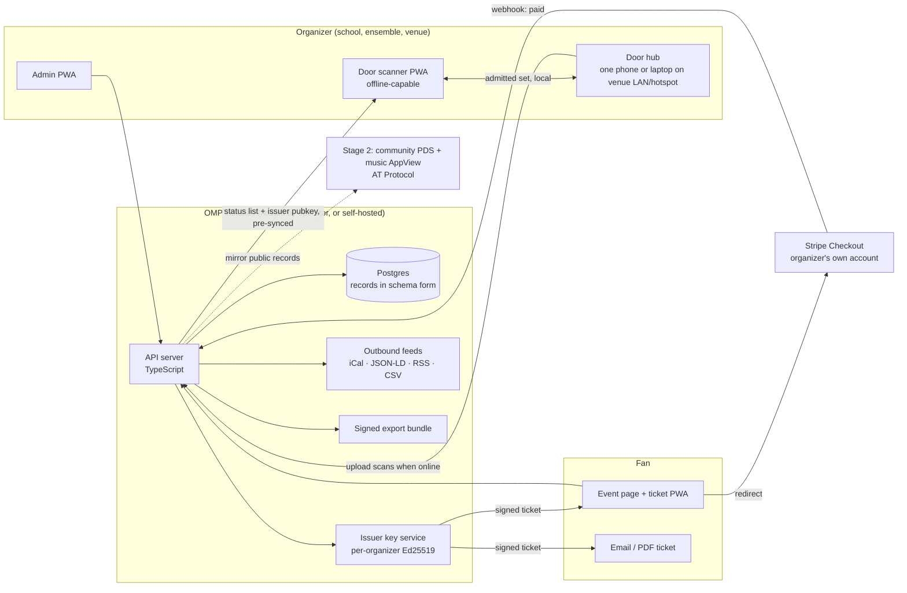

# OMP architecture design

Status: proposal, v0.1, 2026-10-14. Decisions marked **Decided** were made by Ben on 2026-10-14. Everything else is a proposal to be confirmed by the probes in [PROBE_PLAN.md](PROBE_PLAN.md). Evidence comes from [the market research report](../reports/Open%20music%20ticketing%20landscape.md); claims the researchers labeled inference are labeled inference here too.

## 1. Decisions log

| # | Decision | Status | Rationale (short) |
|---|---|---|---|
| D1 | v1 beachhead is school and community ensembles; the artist-to-venue settlement tool is the second wedge | **Decided** | True non-consumption; regressive flat fees on cheap tickets; founder's distribution channel; every Live Nation remedy targets 8,000+ cap venues so the small tier is untouched |
| D2 | No blockchain in v1, no fan wallets ever, no token | **Decided** | Every chain-ticketing project with volume hid the chain; Devcon chose pretix; signed tickets plus a venue-held status list solve the door |
| D3 | Governance: fiscal sponsor holds trademark and schemas; later founder-owned operator LLC runs the hosted instance under license | **Decided** | Prevents founder capture while letting someone be paid to carry payments, refunds and support |
| D4 | Architecture A (open core + hosted operator) built on Architecture B's data model (portable, AT-Protocol-shaped records) | Proposed | Only shape a solo founder can ship and support; schemas make "artists own their records" true later without a rewrite |
| D5 | Each organizer is merchant of record on its own Stripe account; OMP never holds funds | Proposed, gated by probe 4 and 5 | Keeps OMP outside money-transmission and PCI service-provider scope at $0 cost |
| D6 | Tickets are issuer-signed Ed25519 tokens, verifiable offline; door dedupe via a local scanner mesh | Proposed, gated by probe 8 | Works in a gym with no Wi-Fi; one authoritative issuer per event |
| D7 | PWA first; no native apps in v1 | Proposed | Wallet-pass signing needs a legal entity and centralizes a certificate; a 300-cap show does not need an app |
| D8 | Server in TypeScript; SQLite (Node's built-in `node:sqlite`) for the demo and self-host path, Postgres for the hosted multi-tenant instance later; scanner and fan views as PWAs | Adopted 2026-10-15 (SQLite first) | Largest contributor pool; one language across server, schemas and clients; a single-file database makes self-hosting trivial for a school |

## 2. Goals, non-goals, principles

**Goals for v1.** A school or community ensemble director can publish a concert page in five minutes, take free RSVPs or sell tickets at an all-in price with zero platform fee, check people in at the door from any phone with no signal, reconcile cash and card in one sheet, and export everything. Every object they create is theirs, in a published schema, and leaves with them.

**Non-goals for v1.** Settlement and deal memos (schema reserved, not built), booking marketplace, artist discovery, resale or exchange, wallet passes, native apps, split payouts, inbound ActivityPub, AT Protocol publishing, Matrix, blockchain, arena on-sales, bot defense, dynamic pricing, insurance, multi-language.

**Principles that constrain every design choice below.**

1. The venue owns the door and the money. OMP software signs nothing on the venue's behalf that the venue could not sign itself.
2. Artists and organizers own their records. Every object has an owner DID and can be exported as a signed bundle.
3. Decentralize publishing, identity and data; centralize nothing that touches money or admission.
4. Open schemas before features. A feature does not ship until its objects are in the schema doc.
5. Compliance is the default path, not a setting. Redirect checkout, all-in prices, machine-readable refund policy, WCAG 2.1 AA gate.
6. Interoperate, do not replace. Outbound iCal, JSON-LD and CSV from day one; importers before exporters are ever needed.
7. Do not call it decentralized until two independent hosts or indexers exist.

## 3. Candidate architectures and the choice

| | A. Open core + hosted operator | B. AT Protocol data plane + venue-signed tickets | C. Self-hosted local-first venue nodes |
|---|---|---|---|
| Shape | One AGPL app, multi-tenant hosted instance, self-hostable, outbound feeds, full export | Entities write OMP lexicon records to their own or a community PDS; a music AppView indexes; private booking in Matrix or E2EE store; venue issues signed tickets | Every venue or district runs a node; CRDT calendars and settlements; ActivityPub publishing |
| "Artists host their data, venues host theirs" | Weak (export and self-host only) | Strong (signed, portable records under the owner's DID) | Strong for venues, weak for artists |
| Solo-founder build cost | Lowest | Medium | Highest |
| Door and money bar met | Yes | Yes (tickets stay venue-issued) | Yes, but each node carries ops burden |
| Capture risk | Operator becomes the monopoly | Dependence on Bluesky relay and PLC | Volunteer admin burnout, instance data loss |
| Precedent | pretix, Humanitix, Indico thriving | Smoke Signal (45k events), IETF working group; no ticketing precedent | Mobilizon handoff, Attendize dormant |

**Choice (D4): build A with B's data model.** Concretely:

- Year one ships A: one hosted instance, one `docker compose` self-host path, outbound feeds, full signed export.
- From the first commit, every object is defined in a schema document shaped as an AT Protocol lexicon (NSID, record type, JSON schema) and mapped to schema.org where a mapping exists. The hosted instance stores them in Postgres; it does not run a PDS in v1.
- Stage two (trigger in [SCOPE_CHARTER.md](SCOPE_CHARTER.md)): the operator runs a default community PDS and mirrors each entity's public records into a repo under the entity's DID; an entity may point OMP at its own PDS instead. A small open-source AppView indexes OMP records from the public relay. OMP claims "decentralized" only once a second, independent host or indexer is live.
- C stays available as the self-host path for districts, universities and venue co-ops with IT staff, the same organizations that self-host pretix and Indico today.

What this costs us: in year one "artists own their data" is true by export and schema, not by hosting. That is stated honestly in the README rather than papered over.

## 4. System overview



Three boundaries matter:

- **Money boundary.** Card data and funds touch only Stripe and the organizer's Stripe account. OMP sees order metadata and webhook events.
- **Admission boundary.** Admission is decided on the scanner using data synced before doors. The instance being down during the show must not stop the show.
- **Ownership boundary.** Every record carries `ownerDid`; the instance is a custodian, not an owner. Export is signed by the instance and verifiable by anyone.

## 5. Subsystem designs

Each subsystem follows the same shape: decision, how it works, what it rejects, what is deferred.

### 5.1 Identity

**Decision.** Organizations (schools, ensembles, venues) are identified by `did:web` on a domain they control, with the hosted operator issuing a `did:web:<instance>:org:<slug>` fallback for organizations without a domain. Artists get a DID too (`did:plc` once stage two lands; a hosted `did:web` fallback in v1). Fans never get a DID in v1; they authenticate to the fan PWA with passkeys or a magic link, and a ticket binds to an email or a per-ticket holder key, not to an identity.

**How.** Each organization has an Ed25519 issuer keypair generated on creation. In v1 the instance holds the private key in a key service (encrypted at rest, per-tenant). An organization can at any time rotate to a key it holds itself; the public key is published in its DID document. Staff are people with roles on the organization (owner, admin, box office, scanner), authenticated with passkeys.

**Rejected.** Nostr keys (unrecoverable loss is a mainstream UX barrier). Crypto wallets (D2). Social login as the only option (lock-in to a platform the organizer does not control).

**Deferred.** Self-custody of issuer keys by default; `did:plc` for artists; Verifiable Credential issuance for roles.

### 5.2 Records and schemas (the data plane)

**Decision.** One schema document defines every object as an AT-Protocol-style lexicon under a project-owned NSID prefix, with a schema.org mapping where one exists. Placeholder prefix in this doc: `performance.openmusic.*`; the real prefix must be a domain the fiscal sponsor controls (open question Q1).

v1 objects:

| Object | Purpose | schema.org mapping | Owner |
|---|---|---|---|
| `org` | School, ensemble, venue, series | `Organization` / `MusicVenue` / `MusicGroup` | the org |
| `act` | A performing unit: ensemble, band, soloist | `MusicGroup` / `Person` | the act |
| `event` | A dated occurrence at a place | `MusicEvent` | the host org |
| `performance` | One act performing at one event (the performance-database atom) | `MusicEvent.performer` + `subEvent` | shared: references `event` and `act` |
| `ticketClass` | A sellable or reservable class: GA, reserved, free RSVP, donation | `Offer` | host org |
| `order` | A purchase or reservation; references the Stripe session when paid | `Order` | host org (buyer gets a copy) |
| `ticket` | A signed admission credential | `Ticket` | host org (holder gets the token) |
| `doorScan` | One scan event: ticket id, scanner id, time, result | none | host org |
| `program` | Digital program: pieces, performers, notes | `MusicComposition` list (partial) | host org |
| `donation` | A gift tied to an event or org | `DonateAction` | host org |

Reserved, not built in v1: `dealMemo`, `advance` (stage plot, input list, hospitality), `settlementSheet`, `payout`. Their NSIDs are allocated now so the settlement wedge adds records rather than reshaping existing ones.

**Rules.** Every record has `$type`, `ownerDid`, `createdAt`, `updatedAt`, and a content hash. Records are immutable once a dependent record references them (an `order` freezes its `ticketClass` snapshot). Media (posters, press-kit audio, PDFs) is stored by content hash and referenced, never embedded, so a future mirror or CDN can serve it unchanged.

**Why AT shape rather than plain JSON.** Lexicons give us typed records, an NSID namespace other vendors can implement, and a direct path to stage two. They cost nothing in v1 beyond discipline.

**Rejected.** Inventing a bespoke format (nobody else would implement it). ActivityPub objects as the system of record (posts do not migrate on account move; it is a broadcast format, not a record format).

### 5.3 Event publishing and discovery

**Decision.** v1 publishes outbound only: a public event page with JSON-LD `MusicEvent`, an iCal feed per organization, an RSS feed, and a bulk JSON export of all public records on the instance. No inbound federation, no OMP-run directory beyond a per-instance listing.

**Why.** Discovery is where incumbents capture value (Bandsintown's API is read-only and consent-gated; Songkick's went paid). Shipping feeds first means any calendar, newsletter or local listing can index OMP events without asking us. A music-only AppView is the stage-two discovery layer and is deliberately not built until public records exist on at least two hosts.

**Importer.** An Eventbrite importer (events, ticket classes, attendee list with consent flags) ships in v1 so an organizer can leave Eventbrite in one step; Mobilizon shipped Meetup and Eventbrite import for the same reason.

**Deferred.** ActivityPub actor per organization (so Mastodon and Mobilizon users can follow a venue); AT Protocol publishing; the AppView; cross-instance search.

### 5.4 Tickets and the door

**Decision (D6).** The organizer's issuer key signs each ticket as a compact token. Scanners verify offline with the issuer public key and a pre-synced status list, and share an admitted-set over a local hub to stop double entry.

**Ticket token.** A CBOR or compact JSON payload, Ed25519-signed, encoded as a QR code:

```
{ v: 1, iss: <issuer key id>, evt: <event id>, cls: <ticketClass id>,
  tid: <ticket id>, hb: <holder binding: hash of email or holder pubkey>,
  exp: <event end + grace>, sig: <Ed25519 over the canonical bytes> }
```

Optional holder proof (stage two): the fan PWA holds a per-ticket key and signs the current minute, which defeats screenshots without a server, the same idea as SafeTix's rotating codes but verifiable offline.

**Status list.** A Bitstring Status List (W3C Recommendation, May 2025) per event, a few kilobytes, listing revoked or refunded ticket indexes. Scanners download it whenever online and keep the last copy. Tickets issued after the last sync still validate by signature, which is the property pretix's scheme gives and a database-only scanner lacks.

**Dedupe.** Cryptography cannot stop one ticket being admitted twice on two offline scanners. Three modes, chosen per event:

1. **Hub mode (default).** One phone or laptop on the venue Wi-Fi or a phone hotspot runs the hub; scanners post each admit to it and query before admitting. Zero duplicates while the hub is reachable. This mirrors pretix's LAN proxy.
2. **Mesh fallback.** Scanners gossip an admitted-set (a grow-only set CRDT) over the local network when the hub is absent. Eventually consistent; a window of seconds.
3. **Single-scanner or printed list.** For a 150-seat recital one phone and a printed name list are enough. The printed list is generated by the same code path.

All scans upload to the instance when online, with a nonce for idempotent replay. Duplicates that slipped through are flagged in the reconciliation sheet, not hidden.

**Rejected.** Server-lookup validation (fails in gyms). App-bound tickets that require a native app (DICE's model; good anti-tout, wrong for a free recital). On-chain tickets (D2; adds transferability that fights anti-scalping and nothing the signature does not give).

**Deferred.** Holder proof; Apple and Google Wallet passes (require a legal entity's certificate; opt-in hosted module later); issuer-controlled face-value exchange.

### 5.5 Payments, orders, reconciliation

**Decision (D5).** The organizer connects its own Stripe account via Stripe Connect Standard (OAuth). OMP creates direct charges on that account through Stripe Checkout in redirect mode, with no application fee under "Stripe handles pricing". The organizer is merchant of record and carries refunds and chargebacks; Stripe issues its 1099-K; OMP's PCI scope is SAQ A by redirect, which also sidesteps the January 2025 script-attack eligibility criterion that embedded iframes trigger.

**Flow.** Fan picks a ticket class → OMP holds inventory with a short timer (atomic decrement in Postgres) → redirect to Stripe Checkout with the all-in price shown → Stripe webhook `checkout.session.completed` → OMP creates `order` and signed `ticket`s → email and PWA delivery. Free RSVPs skip Stripe entirely. Cash at the door is recorded by the scanner as a `doorScan` with `paidCash`, so the reconciliation sheet shows card, cash, comp and no-show in one place with the deposit total a school treasurer needs.

**Policies as data.** Every event carries a machine-readable refund policy (default: full refund of the all-in price on cancellation), a fee disclosure (platform fee: $0; processor fee: shown), and a tax line the organizer sets. Optional "payout after the event" uses the organizer's own Stripe manual-payout schedule, so fan trust improves without OMP holding anything.

**Second processor.** Square as an adapter behind the same interface once one school asks for it; many districts already have Square.

**Legal footing (added 2026-10-15).** Stripe's Connect documentation states that with direct charges the connected account is the merchant of record, and that setting the `on_behalf_of` parameter shifts that role toward the platform; v1 therefore never sets `on_behalf_of`. FinCEN ruling FIN-2014-R009 holds that a party that never takes possession or control of merchant funds is not a money transmitter, which is the posture direct charges give OMP without relying on the narrower agent-of-payee exemption that California's DFPI has read restrictively. This is the strongest footing found, not a legal opinion; probe 5 still applies before any split-payout feature.

**Rejected.** OMP as merchant of record or platform-held funds (money transmission and reserve exposure a solo founder cannot carry). Embedded card fields. Stablecoins (Stripe stablecoin payouts are in private preview; GENIUS Act rules missed their deadline).

**Deferred, gated by probe 5 and a legal entity.** Stripe Connect separate charges and transfers for automatic venue, artist and promoter splits. That is the feature that makes the settlement wedge pay out automatically, and it is also the point where someone becomes a platform. The schema reserves `payout` for it.

### 5.6 Booking, contracts, communications

**Decision.** Not built in v1. The schema reserves `dealMemo`, `advance` and `settlementSheet`. When the settlement wedge starts, the proposed design is a per-booking private room (Matrix is the only mature open option; a lighter homeserver than Synapse is required, and its 2026 maturity is unverified) or, more cheaply, an operator-hosted end-to-end-encrypted document store, with the documents themselves as local-first CRDTs (Automerge or Loro) and a signed "finalize" snapshot for any money figure. Both parties keep a canonical signed copy.

**The white space to claim early.** No open standard exists for stage plots, input lists, tech riders or advance sheets; every commercial tool exports PDF. Defining `advance` in the schema doc, even before implementing it, is cheap and is the kind of thing a contributor from the live-sound world can own.

### 5.7 Promotion

v1 promotion is the open feeds (5.3), a shareable event page that renders well when pasted into Instagram, Facebook or a school newsletter, a printable poster with the QR link, and CSV export of consenting RSVP emails to whatever mailing tool the organizer already uses. OMP does not send marketing email or SMS in v1 (CAN-SPAM, TCPA and 10DLC registration costs are the organizer's problem to take on deliberately, not ours to absorb).

### 5.8 Performance database

The performance database is not a separate system. It is the set of `performance` records (act × event) that accumulates as organizers publish, plus the `program` records that list repertoire. In v1 it is queryable per instance and exportable in bulk. In stage two, the AppView indexes it across hosts. An artist's performance history is therefore reconstructable from public records by anyone, which is the point: no single party is the archive.

### 5.9 Clients

- **Fan**: event page and ticket view as a PWA; tickets also delivered as email with a PDF so a phone with a dead battery is covered by a printout.
- **Organizer admin**: PWA.
- **Door scanner**: PWA using the browser barcode API, installable, works fully offline after a one-time sync per event. Hub mode runs in the same PWA on the designated device.
- No native apps in v1 (D7). Apple's guideline 3.1.3(e) means in-person tickets must not use in-app purchase anyway, so a PWA loses nothing on payments.

### 5.10 Hosting and operations

- **Hosted instance**: one multi-tenant instance run by the operator. Rough cost at the beachhead scale is a single small VPS plus Postgres and object storage, tens of dollars a month; the research's model puts even 1,000 venues and 20,000 artists at $1k to $5k a month for this shape. Processing fees dwarf it at any real ticket volume.
- **Self-host**: one `docker compose` file (app, Postgres, object storage, reverse proxy with automatic TLS). Documented upgrade path. No per-region instances until the charter's trigger fires.
- **Backups and export**: nightly encrypted backups, and the signed export bundle doubles as the organizer's own backup.
- **Accessibility gate**: WCAG 2.1 AA checked by automated axe runs in CI plus a manual screen-reader pass on checkout and the scanner before each release. For public schools this becomes a procurement requirement under the ADA Title II web rule by April 2027 or 2028.

## 6. Proposed stack (D8)

TypeScript end to end: server (Node, a lightweight HTTP framework), Postgres with the schema document generating both the lexicon JSON and the database types, PWAs built with a mainstream framework, Ed25519 via the Web Crypto API and libsodium on the server. CI runs tests, axe accessibility checks and a schema-conformance check that fails if any API response does not validate against the published lexicon. This is a proposal; the first contributor discussion can change it, but the schema-first rule and the offline scanner requirement are not negotiable.

## 7. Security and privacy posture

- Minimum data: a free RSVP needs a name and optionally an email; a paid order needs what Stripe needs, which OMP does not store beyond the session id.
- Buyer data stays within the organizer's tenant and never aggregates across organizers. That keeps each organizer, and the operator, far below the state privacy-law thresholds (100k residents) the research flagged.
- Issuer private keys encrypted per tenant; rotation supported; export of the public key in the DID document.
- **No student PII in v1 (rule added 2026-10-15).** The hosted instance holds no student accounts, rosters, grades or contact details. A digital program is organizer-entered public content, the same as a printed program. RSVP and order data are adult contact details collected by the organizer. Reason: New York Ed Law 2-d treats click-through terms a teacher accepts as a covered contract even for a free tool, and Illinois SOPPA requires a posted written agreement with any operator that holds student data; several other states follow similar patterns. Keeping student data out of the system is what lets a teacher use the hosted instance without a district contract. Districts that want more (rosters, student performer accounts) get it only through the Student Data Privacy Consortium's National Data Privacy Agreement, signed by the operator or sponsor entity; Runestone Academy, an open-source education project, signed it with one district and other districts in that state's alliance adopted it. A FERPA review precedes any feature that ingests roster data. Sources in `research_notes/Literature and survey data/technical_policy_literature.md`.
- Breach-response runbook template shipped with the self-host package.

## 8. Stage plan

| Stage | Trigger (from the charter) | What changes architecturally |
|---|---|---|
| 1. v1 for ensembles | now | Everything in sections 5.1 to 5.10 |
| 2. Settlement wedge | 10 orgs × 3 events, probes 3/6/7 pass, sponsor signed, second maintainer | `dealMemo`, `advance`, `settlementSheet` implemented; private booking store; Connect splits only after counsel |
| 3. Portable hosting | a second independent host or indexer exists | Default community PDS; entities may bring their own PDS; music AppView; ActivityPub actors; "decentralized" claim allowed |
| 4. Clubs and mid-size venues | stage 2 proven, decree APIs live | Issuer-controlled face-value exchange; optional queue module; VenuePilot-style advance partner; decree open-distribution API client |

## 9. Open questions and risks

- **Q1** Which domain anchors the NSID prefix and the hosted `did:web` fallback? It must belong to the fiscal sponsor, not the founder or the operator LLC.
- **Q2** Does Stripe Connect Standard with direct charges and zero application fee keep OMP outside state money-transmission law in the target states? Probe 5. A California regulator has read the processor exemption narrowly.
- **Q3** Does the no-student-PII rule (section 7) actually keep a teacher's use of the hosted instance outside Ed Law 2-d, SOPPA and similar state laws, as a matter of district practice rather than statute? Probe 2 asks directly, including whether the district has adopted the SDPC National Data Privacy Agreement. If districts require a signed agreement regardless, the operator LLC or the sponsor must exist before the first K-12 pilot, which moves D3's timing; community, church and college pilots are unaffected.
- **Q4** Does the browser barcode API deliver 15 scans a minute per phone on mid-range Android in a dim lobby? Probe 8. If not, a thin native wrapper becomes a v1.x need.
- **Q5** Is a lighter Matrix homeserver mature enough for stage two, or is an operator-hosted encrypted store the pragmatic choice? Unverified in the research.
- **Risk** The operator LLC becomes the de facto monopoly if stage three never happens. Mitigation: the charter's trigger, the sponsor-held trademark, and bulk public export from day one so anyone can stand up an indexer without permission.
- **Risk** Scope. This document already describes six subsystems; only sections 5.1 to 5.5 and 5.9 to 5.10 are v1. The charter's kill and pause criteria apply.
